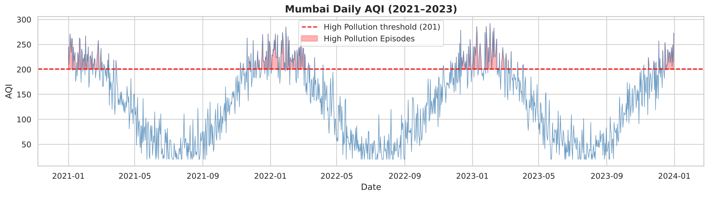
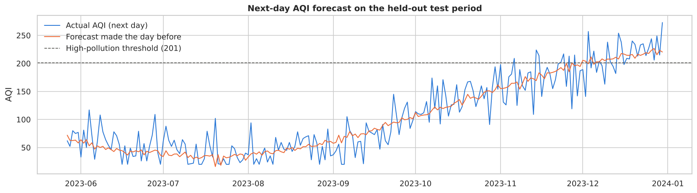

# Mumbai Air Quality: Explaining, Flagging and Forecasting AQI

Regression, classification, clustering and next-day forecasting on three years of daily air-quality data for Mumbai, built as an early-warning prototype for high-pollution days.

Coursework for *Machine Learning and Big Data Applications in Sustainability*, TISS (BSc Analytics and Sustainability Studies, Semester 8).



## Data

The data has 1,095 daily records from January 2021 to December 2023. There are nine features: PM2.5, PM10, NO₂, SO₂, CO, O₃, temperature, humidity and wind speed. The target is AQI. This is a **simulated teaching dataset** modelled on Mumbai's seasonal pattern, and about 5% of feature values are removed to mimic sensor dropouts. Treat the absolute pollutant levels as illustrative.

## What the notebook does

1. **EDA:** missing values, correlations, the AQI time series and pairplots.
2. **Preprocessing:** median imputation, then lag and rolling features built only from past days (`AQI_lag1`, `AQI_lag2`, `AQI_roll3`, `PM25_roll7`).
3. **Regression:** explains today's AQI with simple and multiple linear regression.
4. **Classification:** flags high-pollution days (AQI ≥ 201) with logistic regression, a decision tree and a random forest.
5. **Clustering:** K-means pollution regimes, visualised with PCA.
6. **Next-day forecast:** predicts *tomorrow's* AQI from what is known today, compared with a persistence baseline.

Every model is tested on the **most recent 20% of days**, so no model is scored on days that come before its training data.

## Results

| Explaining today's AQI | R² | RMSE |
|---|---|---|
| Simple LR (PM2.5 only) | 0.87 | 24.4 |
| Multiple LR (all features and lags) | **0.94** | **17.1** |

| Flagging high-pollution days | Accuracy | F1 (high) |
|---|---|---|
| Logistic regression | 0.96 | 0.86 |
| Decision tree | 0.98 | 0.91 |
| Random forest | **0.98** | **0.91** |

| Forecasting tomorrow's AQI | MAE | R² |
|---|---|---|
| Persistence (tomorrow = today) | 29.0 | 0.70 |
| **Linear regression** | **20.4** | **0.85** |
| Random forest | 21.2 | 0.85 |



## Key findings

- **A one-day warning works.** A simple linear forecast reduces next-day error by 30% compared with persistence. In the test period it warned a day ahead for 19 of 28 high-pollution days, with 9 false alarms.
- **Particulates drive the index.** PM2.5 and PM10 are the most important features for explaining and flagging today's AQI, followed by the previous day's AQI. For tomorrow's forecast, the past week's average AQI carries most of the signal.
- **Pollution is seasonal.** K-means finds three regimes: low (mean AQI 54), moderate (134) and high (209). The high regime falls almost entirely between November and March, and the monsoon months are the cleanest.

## Repository

```
notebooks/Mumbai_AQI_Predictive_Modelling.ipynb   Full analysis, executed with outputs
data/mumbai_aqi.csv                                Daily dataset
report/mumbai_aqi_report.pdf                       Written interpretation report (course submission)
```

The report was written for the course submission, which used a random train/test split. The notebook now uses the time-ordered split described above, so its classification figures differ slightly from the report's.

## Running it

```bash
pip install pandas numpy scikit-learn matplotlib seaborn jupyter
cd notebooks
jupyter notebook Mumbai_AQI_Predictive_Modelling.ipynb
```

**Tools:** Python · pandas · scikit-learn · matplotlib · seaborn
