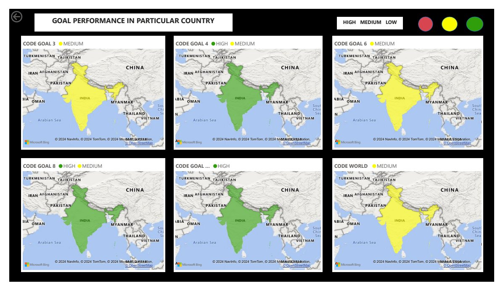
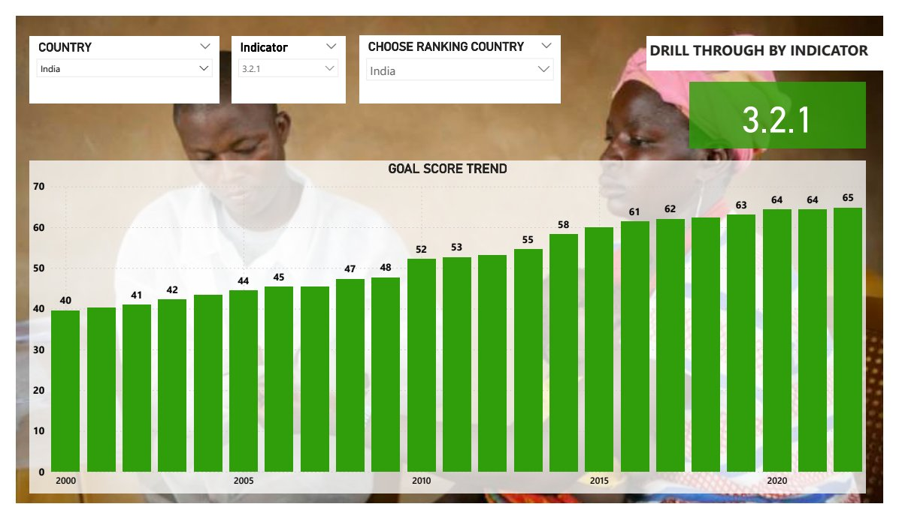

# SDG Performance Dashboard (Power BI)

An interactive Power BI dashboard for five Sustainable Development Goals that together cover the three pillars of sustainability:

- **Social:** SDG 3 (health) and SDG 4 (education)
- **Environmental:** SDG 6 (clean water and sanitation) and SDG 13 (climate action)
- **Economic:** SDG 8 (decent work and economic growth)

It covers every country with available data from 2000 to 2022.

## What it does

- **Drill-through by country:** pick a country and year to see its score on each goal.
- **Performance maps:** each goal is shaded high, medium or low for the selected country.
- **Drill-through by indicator:** follow a single indicator, such as 3.2.1 (under-5 mortality), over time and compare it with another country.
- **Navigation:** clicking an SDG logo on the home page jumps to that goal's page.

## Data preparation

Done in Power Query:
- removed empty and unused columns
- grouped goal scores into bands: low (0–33), medium (33–66) and high (66–100)
- built the country and year slicers and the drill-through pages

## Files

| File | Description |
|------|-------------|
| `sdg-dashboard.pbix` | The dashboard. Open it in Power BI Desktop (free, Windows). |
| `sdg-dashboard-pages.pdf` | Every page exported to PDF, viewable without Power BI |
| `sdg-dashboard-report.pdf` | Write-up of indicator choices, design and insights |

## Tools

Power BI Desktop, Power Query, Bing Maps visual
