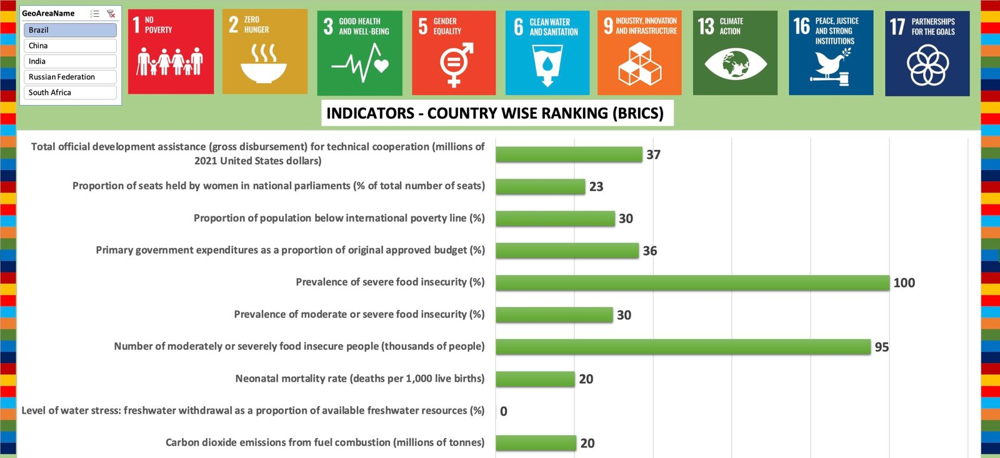

# BRICS Sustainability Report

This project compares Brazil, Russia, India, China and South Africa on SDG indicators from 2015 to 2022. It has two parts: a ranking dashboard and a written report on the trends.

## Approach

1. **Data:** UN Statistics Division SDG Global Database, 2015–2022.
2. **Indicators:** chosen to cover the environmental, social and economic dimensions. They include poverty, food insecurity, neonatal mortality, women in parliament, water stress, CO₂ emissions, government spending and development assistance (SDGs 1, 2, 3, 5, 6, 9, 13, 16 and 17).
3. **Ranking:** countries are ranked indicator by indicator, with one worksheet per goal.
4. **Dashboard:** a country slicer updates the ranking chart for whichever country is selected.

## Findings in brief

- China has by far the highest CO₂ emissions, and South Africa faces the highest water stress.
- India leads in development assistance, and South Africa has the largest share of parliamentary seats held by women.
- Health-coverage indices improved in Brazil, China and India over the period.

The full discussion is in the report.

## Files

| File | Description |
|------|-------------|
| `brics-sustainability-report.pdf` | The written report |
| `brics-ranking-dashboard.xlsx` | Ranking dashboard, working data and pivot tables, with one sheet per goal |

## Tools

Excel (pivot tables, slicers, charts), UN SDG Global Database
