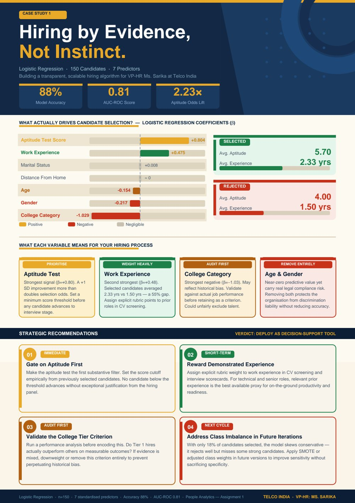
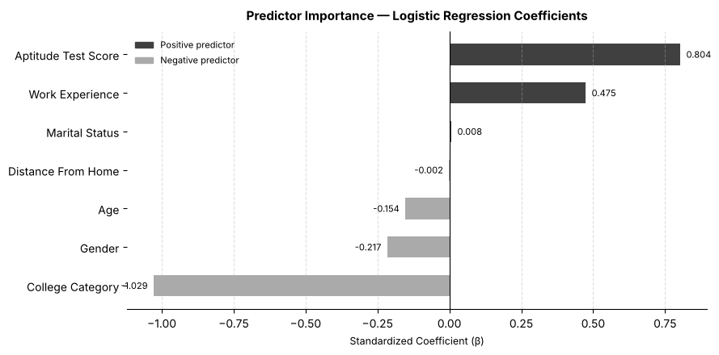
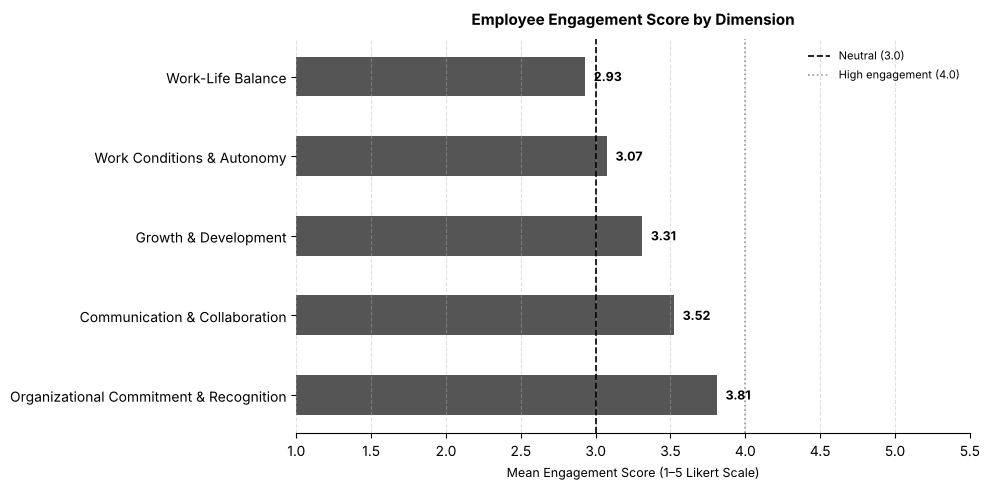

# People Analytics Case Studies

Three HR-analytics case studies from the *People Analytics* course at TISS. Each uses a different technique: logistic regression for hiring decisions, factor analysis for an engagement survey, and linear programming for workforce planning.

<p align="center"><a href="people-analytics-poster.pdf"></a></p>

| | Case | Technique | Folder |
|---|---|---|---|
| 1 | Telco India: candidate selection | Logistic regression | [`telco-india-recruitment`](telco-india-recruitment) |
| 2 | ABL Ltd: employee engagement | PCA and Cronbach's alpha | [`abl-engagement-survey`](abl-engagement-survey) |
| 3 | MediCare Plus: FY26-27 hiring plan | Integer linear programming | [`medicare-workforce-planning`](medicare-workforce-planning) |

---

## 1. Telco India: which candidate attributes predict selection?

A logistic regression on 150 past candidates (18% selected), with seven standardised predictors.



- **Aptitude test score** is the strongest positive predictor (β = 0.80; each standard deviation more than doubles the odds of selection), followed by **work experience** (β = 0.47).
- **College category** has the largest effect of all, and it is negative (β = −1.03): candidates from lower-tier colleges were much less likely to be selected. Because this may encode past bias rather than ability, the recommendation is to audit it against job performance before keeping it.
- **Age and gender** add little predictive value but carry legal and fairness risk, so the recommendation is to drop them.
- **Performance:** in-sample accuracy is 88% (AUC 0.81). On held-out data, five-fold cross-validation gives 85% accuracy and AUC 0.73, against an 82% baseline from always predicting "not selected". The model is useful as a screening aid, not as an automatic decision rule.

## 2. ABL Ltd: what dimensions sit under a 26-item engagement survey?

A principal component analysis of 220 employees' Likert-scale responses. Six components meet the Kaiser criterion (eigenvalue > 1) and together explain 73.5% of the variance. The items group into five interpretable dimensions:



| Dimension | Items | Cronbach's α | Mean (1–5) |
|---|---|---|---|
| Organisational commitment and recognition | 14 | 0.95 | 3.81 |
| Communication and collaboration | 6 | 0.81 | 3.52 |
| Growth and development | 2 | 0.37 | 3.31 |
| Work conditions and autonomy | 2 | 0.60 | 3.07 |
| Work-life balance | 2 | 0.61 | **2.93** |

Work-life balance is the weakest area and the first priority. The growth-and-development scale is unreliable (α = 0.37), so those survey items need redesigning before the next round.

## 3. MediCare Plus: the cheapest hiring plan that meets every constraint

Recommends FY26-27 hiring across 6 roles and 4 hospitals (24 decision variables). The plan must meet regulatory patient-care ratios after expected attrition, a ceiling on specialist supply, the NABH-mandated senior-to-junior nurse ratio, a research-wing requirement in Mumbai and the CFO's budget. Getting there first meant reconciling a deliberately messy workbook: three unreconciled HR rosters, salaries in mixed formats and demand figures buried in memos. The model was solved first as a continuous LP, to check feasibility and read shadow prices, and then as an integer LP for the final plan.

**Result:** 141 new hires at a first-year cost of ₹1,397.5 lakh, ₹102.5 lakh under the budget ceiling. The [report](medicare-workforce-planning/workforce_optimisation_report.pdf) also covers what the model leaves out, such as diversity and internal mobility.

---

## Running the notebooks

```bash
pip install pandas numpy scikit-learn matplotlib seaborn openpyxl
jupyter notebook telco-india-recruitment/recruitment_logistic_regression.ipynb
jupyter notebook abl-engagement-survey/engagement_factor_analysis.ipynb
```

Each notebook reads its data from the `Raw Data` sheet of the workbook in its folder.

**Tools:** Python (pandas, scikit-learn, matplotlib, seaborn) · Excel Solver
