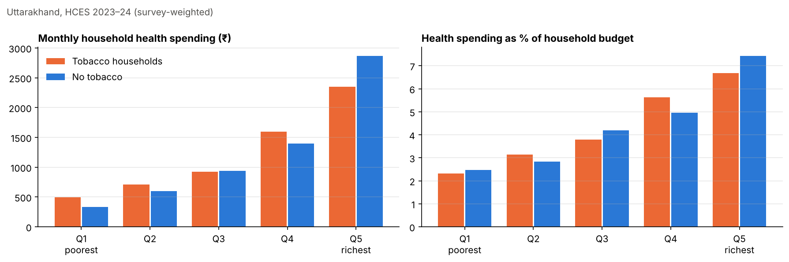

# Uttarakhand Health Survey Analytics

Survey-weighted analysis of Indian government (NSO) microdata for Uttarakhand, covering healthcare use, out-of-pocket spending and household tobacco and intoxicant consumption. The repository has two parts:

| Part | Survey | What's here |
|---|---|---|
| **1. Health care use and costs** | NSS 80th Round, health | Full weighted-analysis pipeline (notebook) |
| **2. Substance use and health spending** | HCES 2023–24 | Processed household dataset (2,749 households) and weighted analysis notebook |

---

## 1. Health care use and out-of-pocket spending (NSS 80th Round)

[`notebooks/nss80_health_analysis.ipynb`](notebooks/nss80_health_analysis.ipynb) links household, person, inpatient and outpatient records. It produces eight survey-weighted tables for Uttarakhand, each broken down by rural/urban, male/female and social group (ST/SC/OBC/General):

1. Inpatient hospitalisation: rate per 1,000, share in public facilities, government insurance coverage and mean out-of-pocket cost (excluding childbirth)
2. Childbirth hospitalisation, using the same metrics
3. Out-of-pocket spending on hospitalisation, split into medical components (doctor, medicines, tests, bed) and non-medical components (transport and other costs)
4. The same breakdown for childbirth
5. Outpatient care use
6. Out-of-pocket spending on outpatient care
7. The five diseases with the largest inpatient burden, each profiled across all groups
8. The five diseases with the largest outpatient burden

**Method:**
- Records from the four survey levels are joined on household and person IDs.
- Net out-of-pocket cost is gross expenditure minus insurance reimbursement.
- Every rate and mean uses the survey weight `w1`. No unweighted averages are used.

**Running it:** the notebook needs the NSS 80th Round Stata files `level_1a`, `level_2`, `level_4` and `level_5` in the notebook folder. These files are available from the [MoSPI microdata portal](https://microdata.gov.in) and are not redistributed here.

## 2. Substance use and household health spending (HCES 2023–24)

Do households that spend on tobacco or intoxicants spend less on health care, which would mean substance spending "crowds out" health spending? [`notebooks/hces_substance_health_spending.ipynb`](notebooks/hces_substance_health_spending.ipynb) answers this with survey-weighted estimates for the 26 lakh households the sample represents.

**Findings:**
- **Substance spending is widespread.** 62% of households spend on tobacco and 49% on intoxicants. Tobacco use is more common in rural households (66%) than urban ones (52%), and it falls steadily with income, from 70% in the poorest fifth to 49% in the richest.
- **The health-spending gap comes from the richest households.** Tobacco households spend less on health care on average (₹1,165 vs ₹1,448 a month). But in the four poorer quintiles they spend about the same or *more*; the overall gap comes entirely from the richest fifth.
- **Substance spending outweighs health spending for poorer users.** In the poorest fifth of user households, monthly spending on tobacco and intoxicants is about 1.8 times their health spending. In the richest fifth it falls below 1.

The comparisons are descriptive. Tobacco households also differ in sector, caste and household composition, so a causal crowding-out claim needs controls or matching on top of these figures.

**Data file.** [`processed_data/hces_uttarakhand_master.csv`](processed_data/hces_uttarakhand_master.csv) has one row per sampled household. It covers:
- demographics, social group, land and cooking fuel
- monthly per-capita consumption (MPCE) and its quintile within the rural and urban strata
- monthly spending on tobacco and intoxicants, with flags for each (`TC`, `IC`, `TC_IC`)
- hospitalisation and medical spending
- PM-JAY enrolment and use
- asset ownership

`Multiplier` is the household survey weight. Divide it by 100 to get the number of households each record represents.

---

**Tools:** Python · pandas · NumPy · matplotlib
