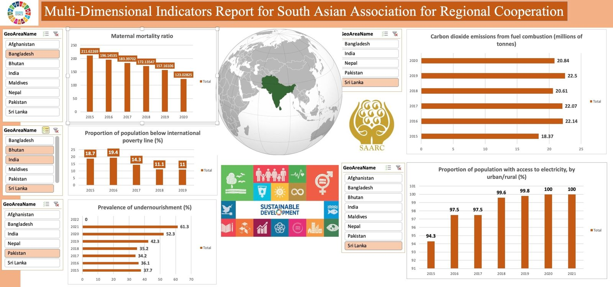

# SAARC Multi-Dimensional SDG Indicators Dashboard

An Excel dashboard comparing the South Asian Association for Regional Cooperation (SAARC) countries: Afghanistan, Bangladesh, Bhutan, India, Maldives, Nepal, Pakistan and Sri Lanka. Each chart has its own country slicer, so different countries can be compared on different indicators at the same time.

## Indicators

| SDG indicator | Measure |
|---------------|---------|
| 1.1.1 | Population below the international poverty line (%) |
| 2.1.1 | Prevalence of undernourishment (%) |
| 3.1.1 | Maternal mortality ratio |
| 9.4.1 | CO₂ emissions from fuel combustion (million tonnes) |
| 7.1.1 | Population with access to electricity (%) |

Data comes from the UN SDG Global Database, 2015–2022.

## Files

| File | Description |
|------|-------------|
| `saarc-sdg-dashboard.xlsx` | Dashboard sheet, plus one data sheet and one pivot sheet per indicator |

## Tools

Excel (pivot tables, pivot charts, slicers)
