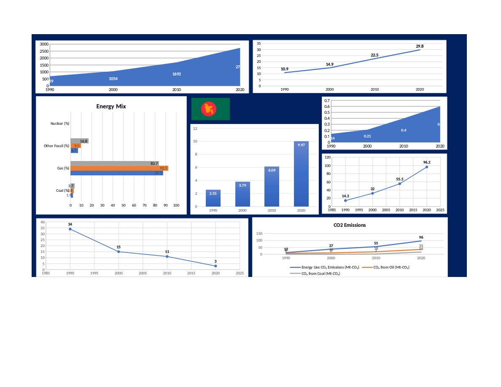
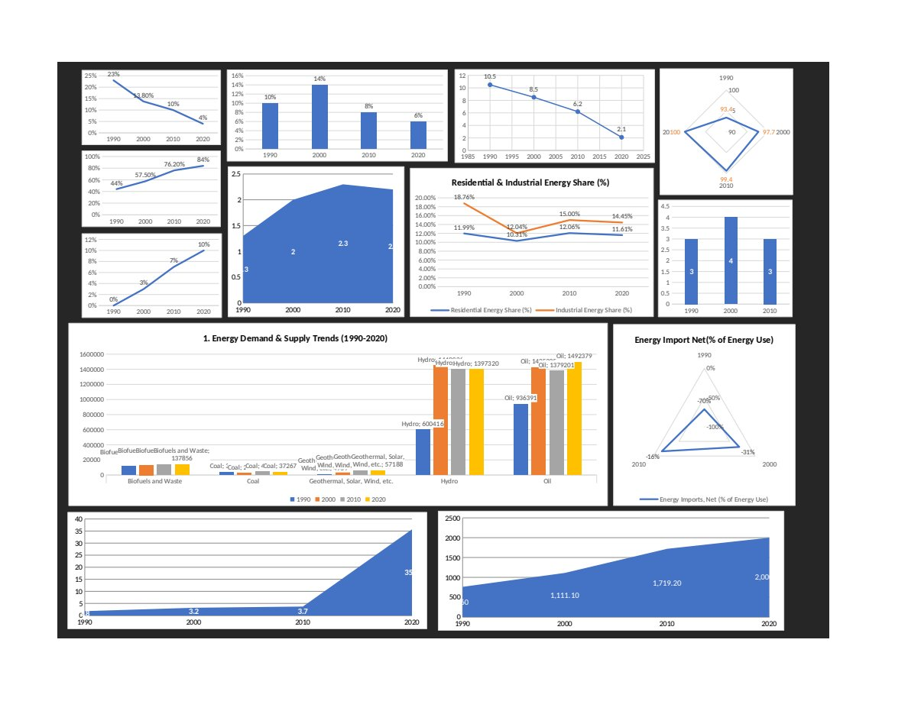

# Energy Profiles: Bangladesh and Egypt

Two single-page Excel dashboards, each profiling one country's energy system across 1990, 2000, 2010 and 2020.

## Indicators covered

- primary energy demand and use per capita
- electricity generation mix (coal, gas, other fossil fuels, nuclear)
- CO₂ emissions per capita and by fuel
- electrification rate and per-capita electricity use
- energy intensity of GDP
- transmission and distribution losses
- residential and industrial shares of consumption
- net energy imports and fuel imports as a share of GDP
- cost of electricity by source and investment in energy

## Highlights

- **Bangladesh:** electrification rose from 14% in 1990 to 96% in 2020, and natural gas supplied most of the country's electricity throughout.
- **Egypt:** a gas- and oil-based system that reached universal electricity access by 2020. Its net energy exports fell from 70% of energy use in 1990 to 16% in 2010.

## Files

| File | Description |
|------|-------------|
| `bangladesh-energy-profile.xlsx` | Bangladesh: data sheet, chart sheets and dashboard |
| `egypt-energy-profile.xlsx` | Egypt: data sheet, chart sheets and dashboard |

## Tools

Excel
