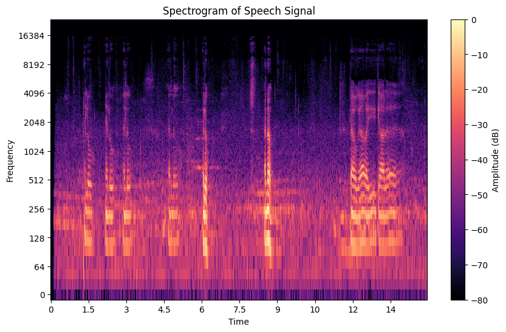
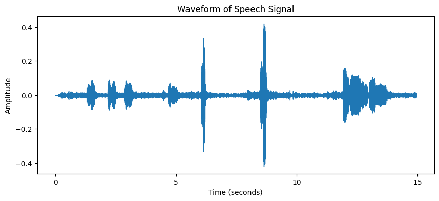
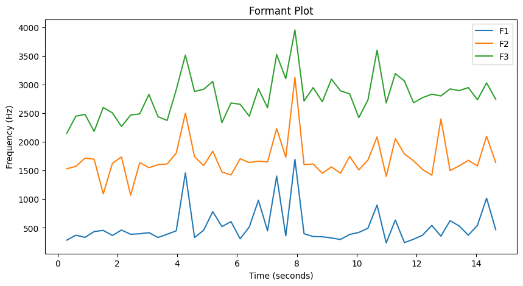

# Speech Signal Processing

A notebook that transcribes a short speech recording in English and Hindi, then analyses its acoustic structure.

## What it does

1. **Speech-to-text:** transcribes the clip with the `SpeechRecognition` library, in English and in Hindi (`hi-IN`). The Hindi pass picks up words the English pass misses.
2. **Signal basics:** loads the audio with `librosa`. The clip is about 15 seconds long, sampled at 48 kHz.
3. **Waveform:** plots amplitude over time.
4. **Spectrogram:** applies a short-time Fourier transform and shows the result in decibels on a log-frequency axis (above).
5. **Formants:** tracks the first three formants (F1–F3) over time with Praat's Burg method, through `parselmouth`.

| Waveform | Formants |
|---|---|
|  |  |

## Running it

Run the setup cell, upload any short WAV recording, and set `AUDIO_FILE` to its name. The original recording isn't included.

## Tools

Python, SpeechRecognition, librosa, matplotlib, NumPy, praat-parselmouth
