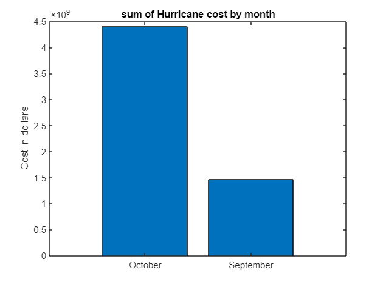

# Storm Events Analysis: 2018 Hurricane Damage (MATLAB)

An analysis of NOAA's Storm Events Database for 2018 that identifies the US states with the most hurricane damage and looks at when and where the events happened.

Hurricane damage in North Carolina and Georgia was concentrated in two months: September (Hurricane Florence) and October (Hurricane Michael).

## Steps

1. **Import:** read the 2018 storm events file with typed import options, parsing dates and damage columns.
2. **Damage:** treat missing property and crop costs as zero and compute total damage per event.
3. **Most affected states:** filter to hurricane events and rank by total damage. North Carolina and Georgia come out on top.
4. **Timing:** sum hurricane damage by month and plot it as a bar chart.
5. **Location:** plot event coordinates for both states on a map of the US (`usamap`, `geoshow`). NOAA records most hurricane events by forecast zone rather than by coordinates, so only events that carry latitude and longitude appear on the map.

## Files

| File | Description |
|------|-------------|
| `storm_events_2018.mlx` | Original MATLAB Live Script, with outputs |
| `storm_events_2018.m` | The same code as a plain script, readable on GitHub (with corrected labels and state-name matching) |

## Running it

Download the 2018 details file (`StormEvents_details-ftp_v1.0_d2018_*.csv.gz`) from the [NOAA Storm Events Database](https://www.ncei.noaa.gov/stormevents/ftp.jsp), unzip it, save it as `data/StormEvents_2018.csv`, and run `storm_events_2018.m`. The mapping steps need the Mapping Toolbox.

## Tools

MATLAB (tables, `groupsummary`, Mapping Toolbox)
