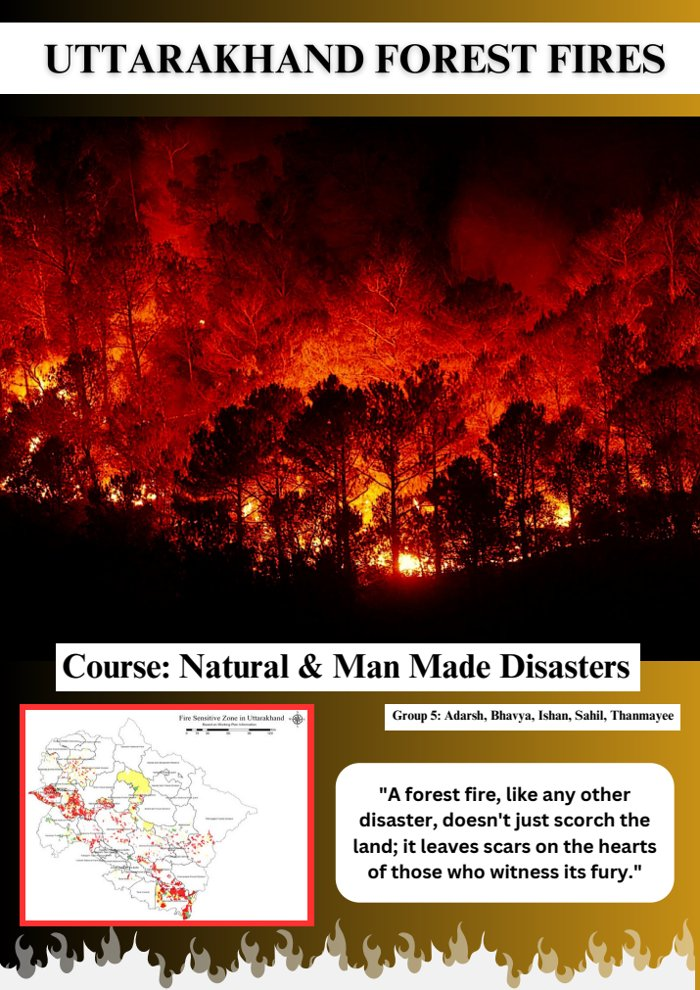

# Uttarakhand Forest Fires 2016: Disaster Case Study

A group case study for the course *Natural and Man-Made Disasters* on the April–May 2016 forest fires in Uttarakhand. The fires burned more than 11,000 acres of forest and killed seven people.

## Contents

- **Background:** how heat, low rainfall and dry vegetation combined, and why pine-dominated forests were especially vulnerable
- **Impacts:** loss of forest and wildlife, worse air quality, and damage to livelihoods and tourism
- **Response:** the roles of government agencies, NGOs and local communities
- **Recommendations:** restoring broadleaf forests, participatory forest management, and early warning using fire-spread modeling, remote sensing and drones

## Team

Group 5: Adarsh, Bhavya, Ishan, Sahil and Thanmayee

## Files

`uttarakhand-forest-fires-2016.pdf`: the full report
