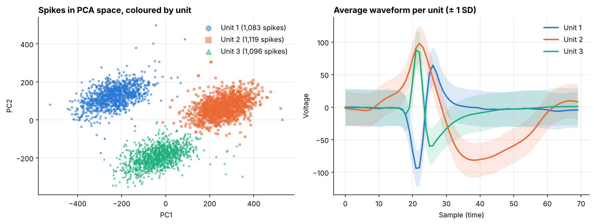

# Neural Spike Sorting with PCA and Gaussian Mixtures

An electrode in the brain picks up spikes from several nearby neurons at once. Spike sorting works out which spikes came from which neuron, using only the shape of each waveform. This project sorts 3,298 unlabelled spikes (70 voltage samples each) into putative neurons.



## Approach

1. **Compress:** apply PCA to the 70-sample waveforms. Three components keep 71% of the variance, and 10 keep 95%.
2. **Cluster:** fit a Gaussian mixture model in the space of the first three components.
3. **Choose the number of neurons:** compare BIC and silhouette scores, and test stability by refitting on 30 random 80% subsamples and measuring agreement with the adjusted Rand index (ARI).
4. **Profile:** compute each unit's average waveform, spread, trough depth and width.

## Results

| Clusters | BIC | Silhouette | Stability (ARI) |
|---|---|---|---|
| 2 | 121,803 | 0.44 | 0.82 |
| **3** | **120,298** | **0.56** | **1.00** |
| 4 | 120,267 | 0.45 | 0.90 |
| 5 | 120,216 | 0.45 | 0.77 |

- **Three neurons.** BIC flattens after three clusters, three has the best silhouette score, and it is the only choice that comes back identically on every subsample. The three units are similar in size (1,083, 1,119 and 1,096 spikes), and 98.5% of spikes are assigned with over 95% confidence.
- **Shapes differ clearly.** Unit 1 has the classic shape: a deep, narrow trough followed by a peak. Units 2 and 3 are inverted, with the positive peak first. Unit 3 is narrow, while Unit 2 is broad, with a slow trough 16 samples after its peak.
- **Limits.** Without ground-truth labels or spike times, the units are putative. A full pipeline would also check refractory-period violations.

## Files

```
notebooks/spike_sorting.ipynb   Full analysis, executed with outputs
data/spikes.csv                 70 × 3,298 matrix: one column per spike
```

**Tools:** Python · NumPy · scikit-learn (PCA, GaussianMixture) · matplotlib
