<picture>
  <source media="(prefers-color-scheme: dark)" srcset="assets/header-academic-dark.svg">
  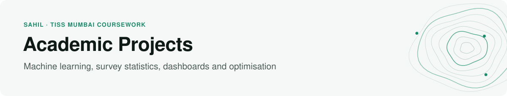
</picture>

[](https://github.com/sahiljangra12/Academic-Projects/actions/workflows/ci.yml)

Twelve projects from my BSc in Analytics and Sustainability Studies at the Tata Institute of Social Sciences, Mumbai. Each folder has its own README covering the question, the method and the results.

**Jump to:** [Machine learning and statistics](#machine-learning-and-statistics) · [Dashboards](#dashboards) · [Optimisation and other analysis](#optimisation-and-other-analysis) · [Reports](#reports)

## Machine learning and statistics

<table>
<tr>
<td width="50%" valign="top">
<a href="01-mumbai-aqi-forecasting">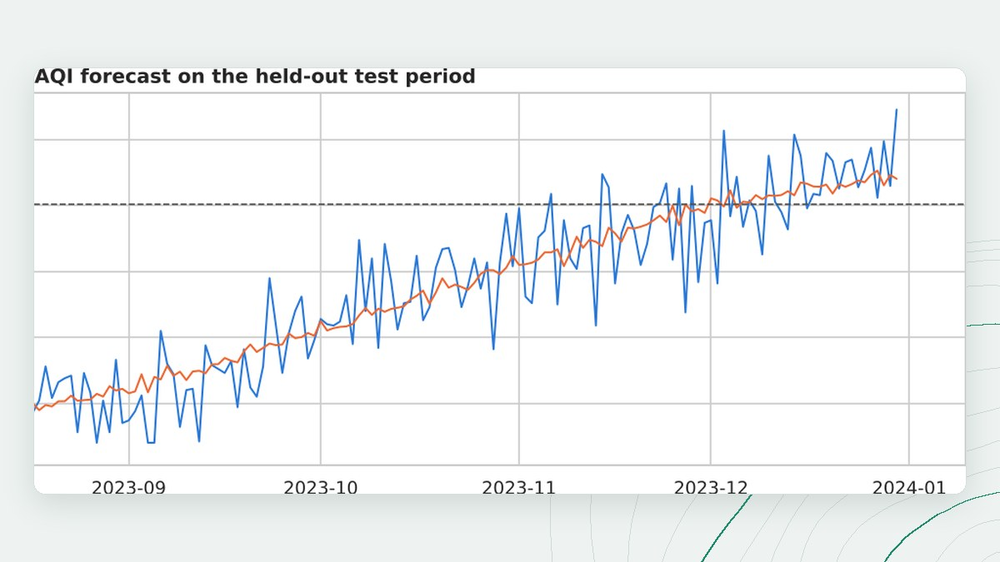</a>
<h3><a href="01-mumbai-aqi-forecasting">Mumbai Air Quality Forecasting</a></h3>
Explains, flags and forecasts daily AQI. The next-day model cuts error by 30% compared with "tomorrow = today" and warned a day ahead for 19 of 28 high-pollution days.<br>
<sub>Python · scikit-learn · time-ordered validation</sub>
</td>
<td width="50%" valign="top">
<a href="02-people-analytics">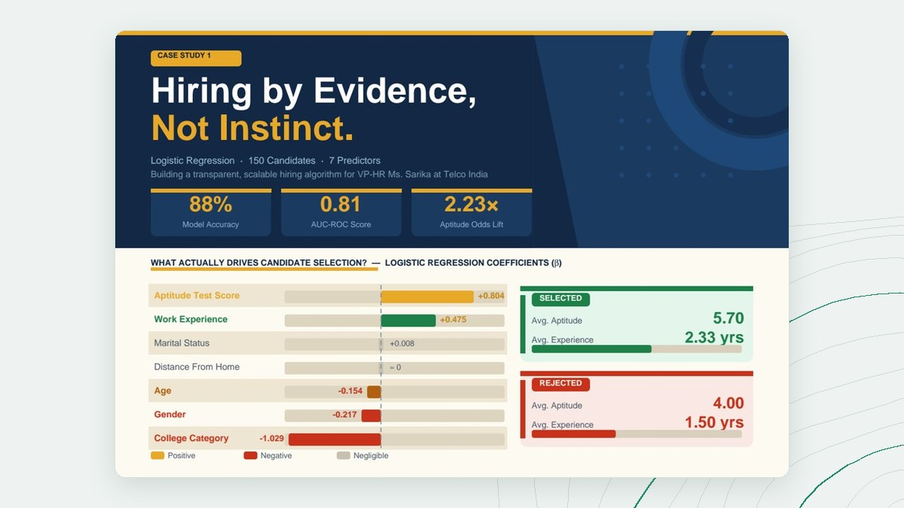</a>
<h3><a href="02-people-analytics">People Analytics Case Studies</a></h3>
A cross-validated hiring model that flags bias-risk predictors, factor analysis of a 26-item engagement survey, and an integer-programming hiring plan for a hospital network.<br>
<sub>Logistic regression · PCA · linear programming</sub>
</td>
</tr>
<tr>
<td width="50%" valign="top">
<a href="03-health-survey-analytics">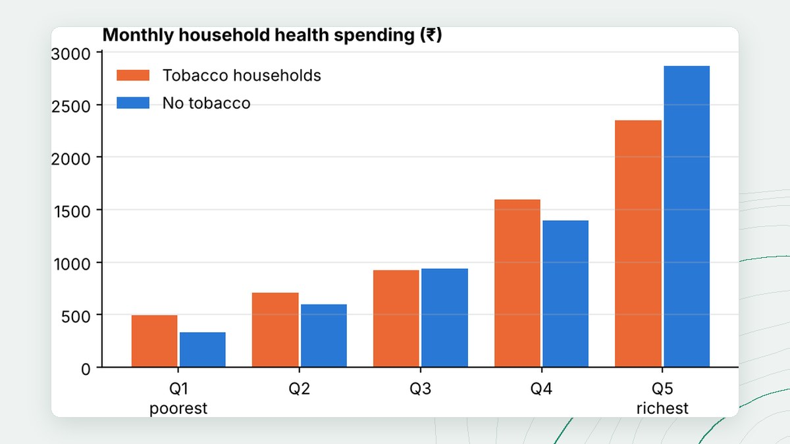</a>
<h3><a href="03-health-survey-analytics">Uttarakhand Health Survey Analytics</a></h3>
Survey-weighted analysis of government microdata on hospital use, out-of-pocket costs, and whether tobacco spending crowds out health spending.<br>
<sub>Python · survey weights · NSS / HCES microdata</sub>
</td>
<td width="50%" valign="top">
<a href="04-speech-signal-processing">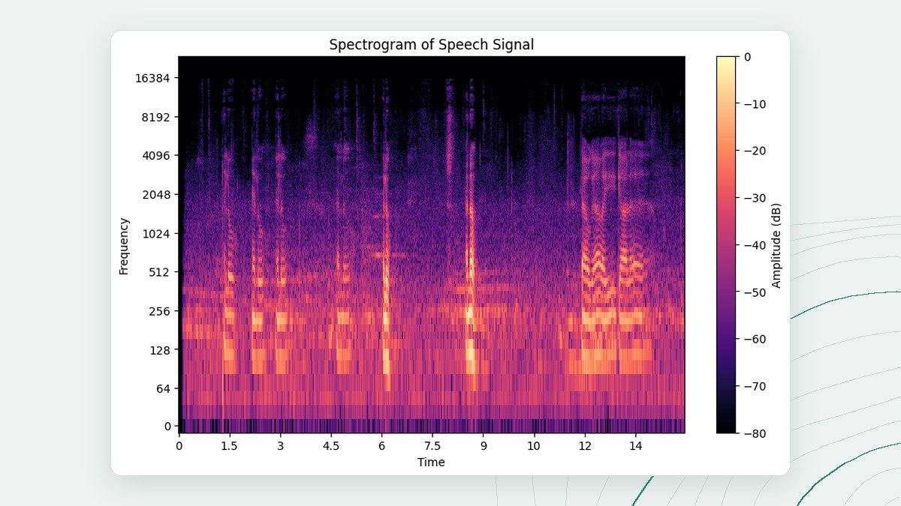</a>
<h3><a href="04-speech-signal-processing">Speech Signal Processing</a></h3>
Speech-to-text in English and Hindi, plus waveform, spectrogram and formant analysis of a recording.<br>
<sub>Python · librosa · Praat</sub>
</td>
</tr>
</table>

## Dashboards

<table>
<tr>
<td width="50%" valign="top">
<a href="05-sdg-powerbi-dashboard">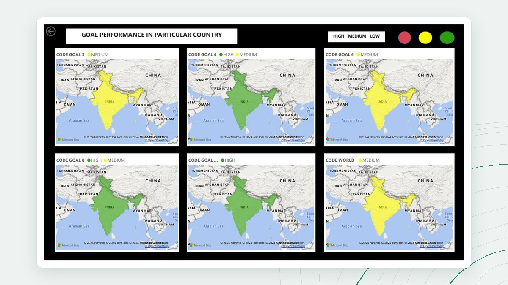</a>
<h3><a href="05-sdg-powerbi-dashboard">SDG Performance Dashboard</a></h3>
Interactive Power BI dashboard tracking SDGs 3, 4, 6, 8 and 13 for every country, 2000–2022, with drill-through by country and indicator.<br>
<sub>Power BI · Power Query</sub>
</td>
<td width="50%" valign="top">
<a href="06-brics-sdg-report">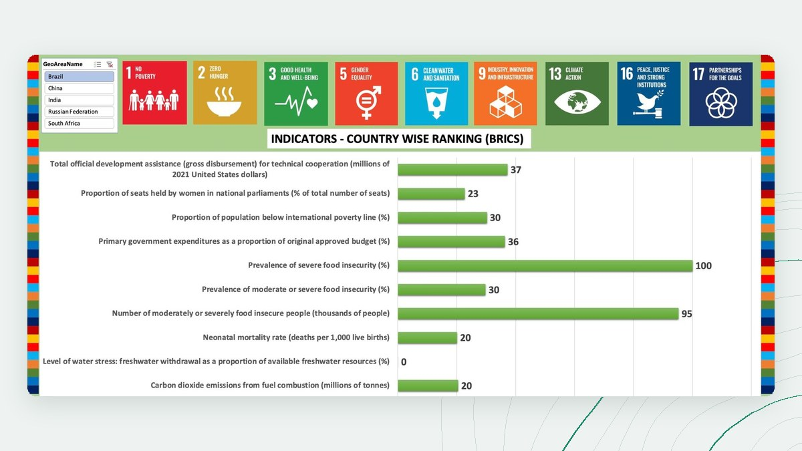</a>
<h3><a href="06-brics-sdg-report">BRICS Sustainability Report</a></h3>
Ranks Brazil, Russia, India, China and South Africa on SDG indicators from 2015 to 2022, with a written report on the trends.<br>
<sub>Excel · UN SDG database</sub>
</td>
</tr>
<tr>
<td width="50%" valign="top">
<a href="07-saarc-sdg-dashboard">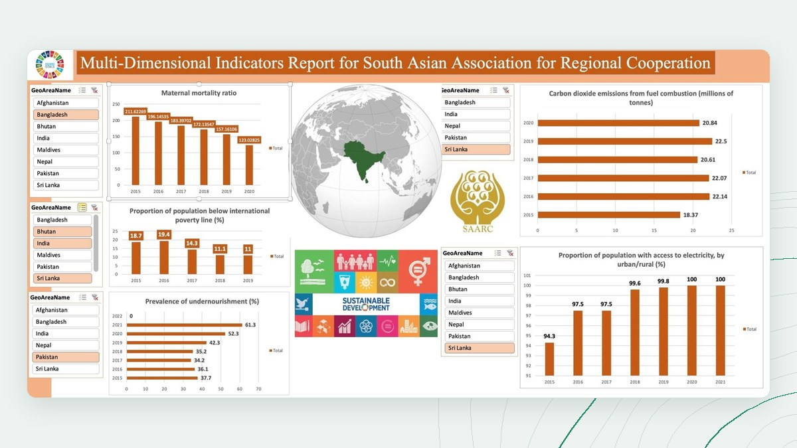</a>
<h3><a href="07-saarc-sdg-dashboard">SAARC SDG Indicators</a></h3>
Compares South Asian countries on poverty, hunger, maternal health, emissions and electricity access.<br>
<sub>Excel pivot charts</sub>
</td>
<td width="50%" valign="top">
<a href="08-energy-profile-dashboards">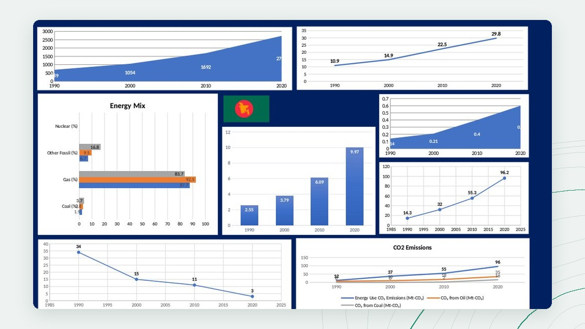</a>
<h3><a href="08-energy-profile-dashboards">Energy Profiles: Bangladesh and Egypt</a></h3>
Energy demand, electricity mix, emissions and electrification for two countries, 1990–2020.<br>
<sub>Excel</sub>
</td>
</tr>
</table>

## Optimisation and other analysis

<table>
<tr>
<td width="50%" valign="top">
<a href="09-storm-events-analysis-matlab"></a>
<h3><a href="09-storm-events-analysis-matlab">2018 Hurricane Damage</a></h3>
Uses NOAA storm-event records to find the states hardest hit by hurricane damage in 2018, and when the damage happened.<br>
<sub>MATLAB</sub>
</td>
<td width="50%" valign="top">
<a href="10-optimization-real-world-problems">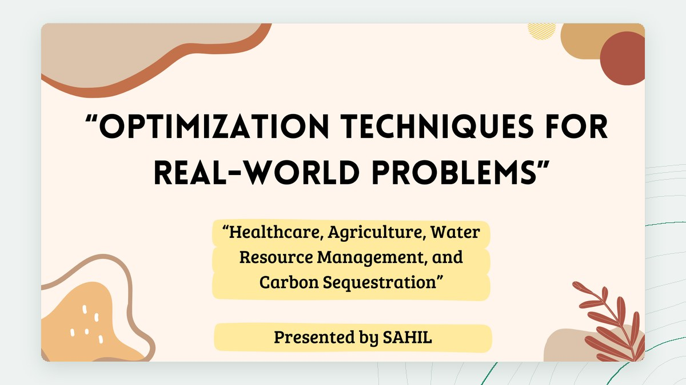</a>
<h3><a href="10-optimization-real-world-problems">Optimization for Real-World Problems</a></h3>
Linear programming models for vaccine allocation, organic farming, household water use and carbon sequestration.<br>
<sub>Excel Solver</sub>
</td>
</tr>
</table>

## Reports

<table>
<tr>
<td width="50%" valign="top">
<a href="11-uttarakhand-forest-fires-2016"></a>
<h3><a href="11-uttarakhand-forest-fires-2016">Uttarakhand Forest Fires 2016</a></h3>
Group case study of the fires' causes, impacts and response, with recommendations.<br>
<sub>Disaster management</sub>
</td>
<td width="50%" valign="top">
<a href="12-sabla-social-impact-assessment">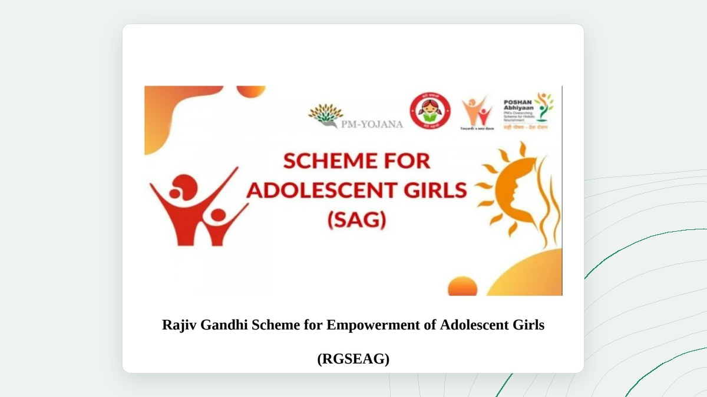</a>
<h3><a href="12-sabla-social-impact-assessment">SABLA Social Impact Assessment</a></h3>
Problem-tree and objective-tree assessment of India's national scheme for adolescent girls.<br>
<sub>Social impact assessment</sub>
</td>
</tr>
</table>

---

## Running the notebooks

```bash
pip install -r requirements.txt
jupyter notebook
```

On every push, continuous integration re-runs the notebooks that use bundled data (air quality, people analytics and the HCES analysis) and checks that every link in these READMEs resolves.

**Related:** the [undergraduate thesis](https://github.com/sahiljangra12/Thesis) analyses planetary pressure and development across 182 countries.<br>
**Contact:** Sahil · MSE Data Science, Johns Hopkins University · [sfnu1@jh.edu](mailto:sfnu1@jh.edu) · [sahiljangra12 on GitHub](https://github.com/sahiljangra12)
