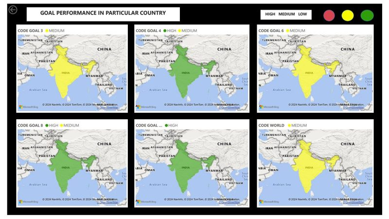
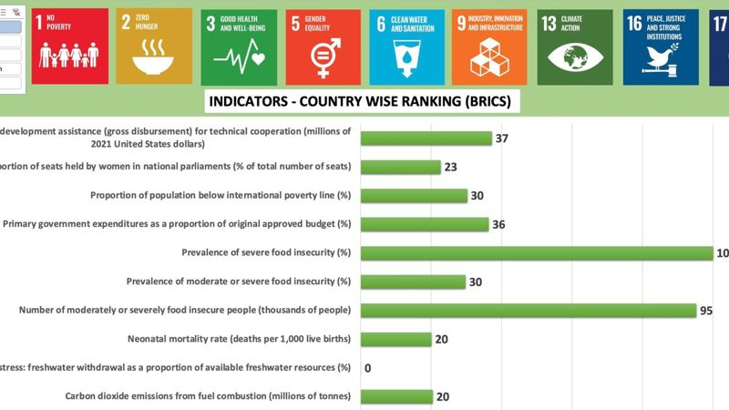
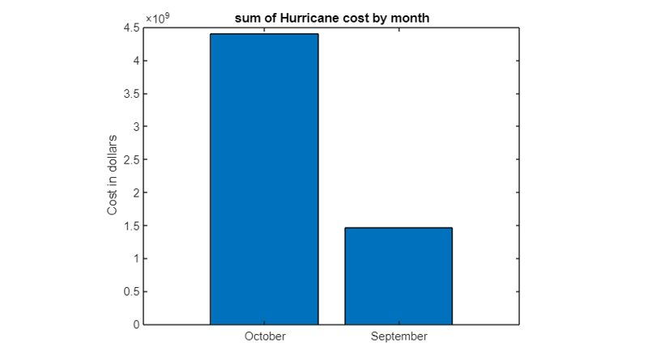
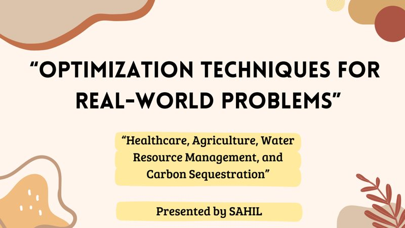
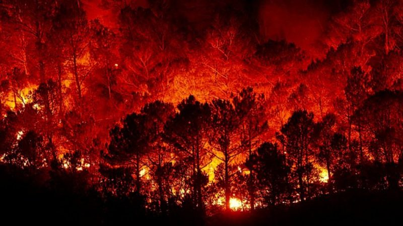
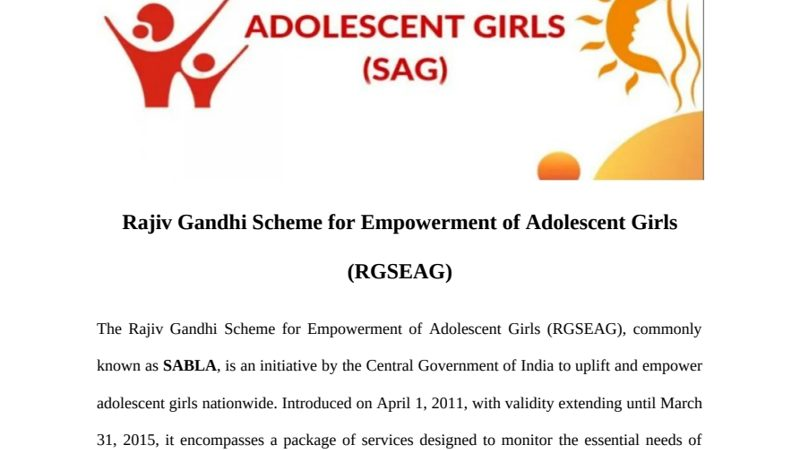

# Academic Projects

Coursework from my BSc in Analytics and Sustainability Studies at the Tata Institute of Social Sciences, Mumbai. Most projects use UN Sustainable Development Goal data to compare countries and track progress, using Power BI, Excel, MATLAB and Python.

## Dashboards

<table>
<tr>
<td width="50%" valign="top">

<h3><a href="01-sdg-powerbi-dashboard">SDG Performance Dashboard</a></h3>
Interactive Power BI dashboard tracking SDGs 3, 4, 6, 8 and 13 for every country, 2000–2022, with drill-through by country and indicator. 
Power BI · Power Query
</td>
<td width="50%" valign="top">

<h3><a href="02-brics-sdg-report">BRICS Sustainability Report</a></h3>
Ranks Brazil, Russia, India, China and South Africa on SDG indicators from 2015 to 2022, with a written report on the trends. 
Excel · UN SDG database
</td>
</tr>
<tr>
<td width="50%" valign="top">

<h3><a href="03-saarc-sdg-dashboard">SAARC SDG Indicators</a></h3>
Compares South Asian countries on poverty, hunger, maternal health, emissions and electricity access, with a slicer on each chart. 
Excel pivot charts
</td>
<td width="50%" valign="top">

<h3><a href="04-energy-profile-dashboards">Energy Profiles: Bangladesh and Egypt</a></h3>
Energy demand, electricity mix, emissions and electrification for two countries, 1990–2020. 
Excel
</td>
</tr>
</table>

## Analysis

<table>
<tr>
<td width="50%" valign="top">

<h3><a href="06-speech-signal-processing">Speech Signal Processing</a></h3>
Speech-to-text in English and Hindi, plus waveform, spectrogram and formant analysis of a recording. 
Python · librosa · Praat
</td>
<td width="50%" valign="top">

<h3><a href="05-storm-events-analysis-matlab">2018 Hurricane Damage</a></h3>
Uses NOAA storm-event records to find the states hardest hit by hurricane damage in 2018, and when the damage happened. 
MATLAB
</td>
</tr>
<tr>
<td width="50%" valign="top">

<h3><a href="09-optimization-real-world-problems">Optimization for Real-World Problems</a></h3>
Linear programming models for vaccine allocation, organic farming, household water use and carbon sequestration. 
Excel Solver
</td>
<td width="50%" valign="top"></td>
</tr>
</table>

## Reports

<table>
<tr>
<td width="50%" valign="top">

<h3><a href="07-uttarakhand-forest-fires-2016">Uttarakhand Forest Fires 2016</a></h3>
Group case study of the fires' causes, impacts and response, with recommendations. 
Disaster management
</td>
<td width="50%" valign="top">

<h3><a href="08-sabla-social-impact-assessment">SABLA Social Impact Assessment</a></h3>
Problem-tree and objective-tree assessment of India's national scheme for adolescent girls. 
Social impact assessment
</td>
</tr>
</table>

---

**Related:** the [undergraduate thesis](https://github.com/sahiljangra12/Thesis) analyses planetary pressure and development across 182 countries.
**Contact:** Sahil · MSE Data Science, Johns Hopkins University · sfnu1@jh.edu
